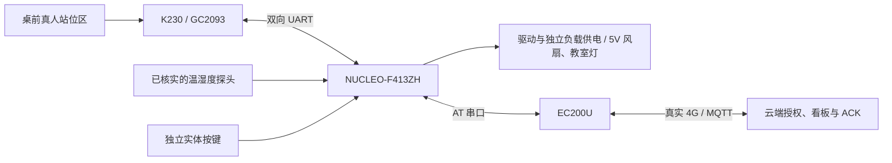

# EcoVision 桌面微型教室搭建方案

2026-11-16 · 设计草案 · 对照 EcoVision 公共契约 1.0.0

把桌面模型做成控制结果的展示端。真人进入 K230 固定视场后，STM32 控制模型里的教室灯和风扇。EC200U 上报后，观众可在已有云端看板看到人数、温度、输出和命令确认。现有二维网页保留模拟入口，用于事先排练和复现故障。实物模式的独立接入仍待联调。

| 搭建方式 | 适用场合 |
| --- | --- |
| 裸板联调台 | 最快验证供电、串口和负载。装模型前先用这套跑通核心。 |
| 开顶微型教室 + 后部设备区（推荐） | 同时保留实物可见性与维修空间。适合作为交付形态。 |
| 带舵机和干簧管的通风窗模型 | 可展示自动开关窗、关窗到位和关窗失败。先在小台架上验证，再装到教室侧墙。 |
| 带步进电机的电动窗帘 | 可演示帘布平移、回零和端点保护。固定在同一面侧墙的另一侧，给窗扇留出摆动空间。 |

## 摆放与布局

建议用现有纸板、泡沫板或闲置底板先做约 50 × 35 cm 的开顶模型，尺寸按实物板卡和插头余量调整。前方放课桌、墙灯和带网罩的风扇，在出风口外固定纸飘带让风量可见，确保纸带够不到扇叶。后部固定 STM32、继电器、电源及 EC200U，保留 USB、调试和电源插拔空间。门和灯环设在正面，侧墙预留模型窗和舵机支架位置。实际温湿度探头放在有空气交换的位置，避开板卡散热和风扇直吹。

摄像头支架固定朝向桌外真人区，贴出 0–5 人站位标记，以实拍画面调整距离和角度，确认多人不被桌面或其他人遮挡。桌面小人用于解释布局。人数实测使用真人，网页模拟时才用滑块设定人数。两种演示均保留来源标记。

## 模块分工

| 已有或候选模块 | 装在哪里、做什么 | 何时接入 |
| --- | --- | --- |
| K230 庐山派、NUCLEO-F413ZH、EC200U | K230 拍桌前真人，STM32 控制现场负载，EC200U 做真实 4G 回传与下行。 | 核心，按已核对的端口和电平联调。 |
| 5V 风扇、普通 LED 或小灯、实体按键 | 出风口、教室照明、前面板本地接管。普通 LED 使用合适的限流，负载按额定电流选驱动。 | 核心。先核对风扇、电压和按键库存。 |
| 2 路 5V 高低电平触发继电器 | 优先试一路切换 5V 风扇，另一路留给合适的 5V 灯或单独测试负载。使用常开触点，空载验证 STM32 上电、复位、掉电时保持释放。 | 可用于核心，但先验证 3.3V 控制兼容、输入是否回灌、触发极性、触点直流能力和风扇启动电流。必要时由嵌入式同学加匹配驱动。 |
| 12 位 WS2812 灯环 | 装在正面作状态灯，低亮度显示绿＝自动正常、蓝＝远程租期、黄＝故障或离线、红＝本地关闭，并贴颜色图例。建议先只做三种模式，故障效果按联调进度加。 | 本地副显示。教室照明用独立灯。接入前核对实际灯珠版本、DIN 门限、电源容量，必要时转换信号电平；软件驱动不得阻塞串口。 |
| 位置舵机、干簧管模块 + 小磁铁 | 舵机用短连杆带动模型窗。干簧管固定在窗框，磁铁固定在窗扇的闭合边，确认实际关窗到位。 | 本地扩展，机械和电气验收单独进行。 |
| 蜂鸣器 | 固定在前面板后，只在进入 `LOCAL_OFF` 时短响一次，便于听见接管动作。 | 可与灯环一并加装；先确认有源/无源、额定电压及驱动电流。 |
| 三合一 TVOC/CO₂/甲醛商品页所示模块 | 作为实验性读数区，先确认丝印、主芯片、供电和输出格式，再记录相对趋势或原始读数。截图无法确认测量原理、精度或单位。 | 独立台架先行。核实是否输出 eCO₂、等效或估算值后再命名。主链路仍需独立的有效温度来源。主动输出型若为 UART，单独用匹配电平的 USB 转串口核对，避免占用核心双串口。 |
| PD42S1 闭环驱动器和 42 步进电机 | 驱动模型窗帘沿横向导轨移动。图三为商品页，确认到手的驱动版本、电机和配套线材。 | 独立扩展台架，接实物限位后再做自动往返。 |
| 830 孔面包板、杜邦线、2×20 / 2×15 排母 | 面包板搭按键、磁簧和低电流信号，杜邦线做台架跳线。下单项里 2×20 标 2.00 mm，2×15 标 2.54 mm，按实物间距分格。 | 可立即整理。定型后固定插头与线束，电源大电流路径使用适合的电源线和接线端子。 |
| 现有电池和稳压电源模块 | 台架先用已验证稳压电源，分别核对板卡入口、5V 负载支路、EC200U 载板电源入口。匹配的成品电池电源可留作后续短时移动展示。 | 优先复用。用实测待机、风扇启动与 4G 发射时的供电稳定性核实容量。电池方案确认保护、输出电压和持续/峰值电流后单独测试。 |

灯环、通风窗、窗帘、蜂鸣器与气体读数在本期均可作为本地扩展展示。网页需要显示真实扩展状态时，先提交总控明确数据来源、字段和兼容方式。现有 `fan_out` / `led_out` 对应驱动逻辑，风扇是否实际转动用目视、飘带或独立反馈验证。

## 通风窗的机械、电气和状态

1. **窗框和连杆。** 侧墙开一扇约 8 × 10 cm 的轻质侧铰窗，先用硬纸板试做。舵机固定在墙后，摇臂通过可调短连杆接到窗扇。手推确认无卡滞、连杆两端都不过死点，再空载校准舵机，装连杆后从小行程开始调整。开、关指令都留机械余量，关到位时无需舵机长期顶住窗框。调完后用罩挡住连杆和夹手位置。
2. **干簧管位置。** 固定在远离铰链的窗框边，磁铁固定在对面的窗扇上。舵机不通电时先用手开合窗扇，调整磁铁方向和距离，确认窗扇贴合时稳定触发，留明显缝隙时释放。接 STM32 后再通过消抖确认。根据模块丝印、供电和输出电路核对 DO 极性及电压。条件允许时让断开信号在实测中落到「未确认关闭」。普通单路干簧管无法区分未贴合、磁铁脱落和断线，也无法报告开窗角度。
3. **舵机供电和控制。** 先确认是能按指令定位的舵机，再按该型号核对电源、控制脉冲、信号门限与动作电流。STM32 用空闲定时器输出舵机控制脉冲，舵机用满足额定电压和瞬态电流的供电支路。非隔离控制信号需要共地，舵机电流由其电源支路承担。首次上电先拆下连杆试动作，并验证复位不会意外带动窗扇。参考 [Pololu 舵机控制接口](https://www.pololu.com/blog/16/electrical-characteristics-of-servos-and-introduction-to-the-servo-control-interface) 和 [Littelfuse 磁簧开关触发说明](https://www.mouser.com/pdfDocs/littelfuse-mvsr-20e-app-note-activation.pdf)。

| 操作或反馈 | 窗户状态与处理 |
| --- | --- |
| 上电，尚无稳定读数 | 显示「未知」，先读取干簧管，不执行复位寻位动作。 |
| 发出开窗请求 | 舵机走已校准的开窗行程。干簧管释放后只确认「离开关闭位置」。 |
| 发出关窗请求 | 显示「关闭中」。干簧管稳定触发后才显示「关窗到位」。 |
| 关窗超过实测行程所需时间加余量，反馈仍未触发 | 显示「关窗未确认」，结束本次驱动，等待人工检查。台架先验证实际舵机的停驱方式能够释放顶压力。状态机使用非阻塞计时，不自动反复顶窗。 |
| 到位后反馈释放 | 撤销「关窗到位」，显示「未确认关闭」。 |

先用独立测试入口做本地开关窗。自动演示可由嵌入式组在扩展模式中消费已确认的占用状态和温控需求。建议有人且需要通风时开窗，确认无人后关窗。自动扩展关闭或感知无效时暂停发起新的自动动作。先记录设计效果，再由总控选定触发条件和本地接管后的窗户动作。网页模拟可分别注入「关窗到位」「有缝未到位」和「磁簧失去反馈」。实物网页需要实际干簧管状态来源；公共契约 1.0.0 当前未定义窗户命令、遥测或 ACK 字段，由总控确认扩展接口后对接。

## 步进电动窗帘

**先做横向单开帘。** 用轻薄布或薄纸做帘，帘布一端固定，另一端连到轨道上的滑块。若手头有同步带，两端各放一个轮，步进电机带动主动轮，滑块固定在同步带的一侧，帘布沿独立导轨移动。把较重的电机固定在底板或硬支架上，皮带轮与滑块夹点加罩。窗帘轨放在墙内侧，舵机窗扇向另一侧打开。先用手推帘布，验证窗扇在完整摆动范围内够不到帘布、连杆和皮带。

**回零和反馈。** 左右端各使用独立限位开关，开关由帘布滑块触发，动作点留在机械挡块前。现有干簧管继续检测窗扇。组装后先手动确认限位和移动方向，再通电低速点动。上电初始显示「位置未知」，操作人员确认轨道无障碍后触发低速回零，以全开端作为原点。若启动时全开端已触发，按已验证的方向短距离离开再低速接近，重新获取边沿。回零设最大时间或距离，两端反馈同时触发、回零超时或驱动器报警时立即停止本次运动并等待排查。行进方向的限位触发后停止继续向该端驱动。窗帘两端分别用对应限位确认，中间开度可在传动验收后以行程估算显示。电机编码器反馈的是轴位置，皮带或帘布脱开时仍需看滑块反馈和实际帘布位置。参考 [Oriental Motor 原点与限位说明](https://www.orientalmotor.com/stepper-motors/technology/eliminating-external-sensors-az-series-stepper-motor.html)。

**供电和调试。** 驱动器依据实物版本手册和电机铭牌接独立低压直流电源，确认接口、电平、额定电流、使能行为与停机方式。先在不装帘布的台架上测低速、低加速度和满足轻载行程的电流或力矩，再接传动。窗帘设备区保留易触达的断电开关。若实物版本支持且工程资源允许，可考虑用 STM32 空闲定时器的脉冲与方向接口，保留 K230 与 EC200U 的双串口。出厂设置或断电记忆需按实物核对，首轮验证复位时无意外运动。参考 [正点原子 PD42S1 资料入口](https://www.openedv.com/forum.php?mod=viewthread&tid=353176)。

**演示顺序。** 第一版用独立本地按钮或调试入口做「回零 → 拉开 → 拉合」，观察两端限位。第二版接入经确认的占用状态，有人时拉开表现利用自然光，确认无人后拉合。自动触发条件和本地接管后的动作由总控确认。窗帘的虚拟状态可在模拟沙盒单独演示；实物状态和远程动作需要经批准的扩展接口。

## 搭建顺序

1. **台架上电。** 给主控、通信和执行区贴标签，逐板验证供电。先空载测继电器和驱动，分别测 MCU 上电、复位、关机，再接 5V 负载。要互通的非隔离信号按原理图共参考地，避免把不同电源的输出直接并联。EC200U 按实际模组或载板资料接指定电源口，发射供电按实物验证。台架涉及的负载限 5V 低压。
2. **跑通本地控制。** 先验收 K230 人数和 STM32 帧接收，再接入灯、风扇与实体按键。确认真人进出与开关灯。温度探头存在且已验证时再做真实温控。若暂时缺探头，可用二维网页排练温控，或让嵌入式组在独立测试模式注入并标记“模拟温度 / 实物输出”，记录为混合联调。
3. **接入真实 4G。** 保持本地控制运行，使用现有云看板先看真实遥测，再发授权命令和观察 ACK。单独断开数据链路并恢复，验证 STM32 自动逻辑持续运行。网页的模拟预设用于复现输入时间线，实物遥测由云接入。
4. **装入模型并冻结。** 先固定主链路和走线，再逐个加蜂鸣器、灯环、通风窗和窗帘。每次加装后检查复位默认关闭、两路 UART 通信、电机动作与 4G 发射时压降。通风窗、窗帘和气体模块先独立验收，再按进度决定是否装入最终模型。

## 面向验收的演示顺序

| 观众操作 | 现场观察与应记录的结果 |
| --- | --- |
| 一人进入视场，再离开 | 连续 3 个新鲜有效正人数帧确认有人，灯亮。连续有效 0 人满 30 秒后两路关。记录进入、首个有效零帧与输出时间。 |
| 有人时通过已验证探头使温度跨阈值 | ≥28℃持续 5 秒开风扇，≤27℃持续 5 秒关。用纸飘带和视频展示物理动作，同时保存温度和输出记录。 |
| 授权远程切换，再长按实体按键 | 看板显示 PENDING，收到关联 ACK 后显示结果，当前状态随后由新鲜遥测更新。长按进 `LOCAL_OFF`，两路关闭，短按恢复 AUTO。安装蜂鸣器后可同时听到提示。 |
| 在 AUTO 下通过受控方式中断 EC200U 数据链路 | 保持 STM32 与 K230 供电和通信，观察进出仍能触发本地控制。云端 15 秒无新鲜遥测显示过期并禁用下发，连接恢复后展示当前状态。 |
| 在 AUTO 下停止视觉心跳 | 使用预先验证的停发方式，观察 5 秒失效显示未知，连续关键故障 60 秒后两路关闭。记录云端与本地时间。 |
| 正常关窗、模拟未贴合、移开磁铁 | 正常关窗显示「关窗到位」。用移动磁铁或手动控制悬空连杆复现未到位，确认超时显示「关窗未确认」且无持续顶窗。到位后移开磁铁，确认撤销到位。记录动作、反馈变化和电源状态。 |
| 将窗帘滑块放在中间，再上电、回零、拉合 | 上电保持静止，主动回零后记录全开限位，再拉合记录另一端限位。空载条件下单独验证限位反馈缺失时可超时停机，并检查窗帘拉合时通风窗仍可完整开闭。 |

按项目关口推进：11 月 20 日前完成视觉到本地控制，11 月 24 日前完成真实 4G 和授权控制，11 月 25 日冻结核心，11 月 27 日完成 8 小时综合运行。若加分模块影响上述进度，从核心验收配置移出，保留独立展位。

本轮交付为设计方案。软件测试或硬件实测待执行。主链路接线先核对 EC200U 实物载板、电源铭牌、5V 风扇、继电器和温湿度模块。通风窗独立核对舵机与干簧管实物和供电；窗帘核对 PD42S1 版本、电机铭牌、兼容电源、导轨传动件和两个限位开关的库存。

参考：[EcoVision 统一接口](../docs/INTERFACES.md)、[嵌入式模块资料核对](../docs/modules/embedded.md)、[Quectel EC200U 硬件设计](https://www.quectel.com/content/uploads/2024/02/Quectel_EC200U_Series_Hardware_Design_V1.2.pdf)、[Worldsemi WS2812B 系列版本说明](https://www.world-semi.com/web/index.php?classid=22&id=587&lanstr=en&topclassid=19)、[Telaire CO₂ 传感器选型指南](https://amphenol-sensors.com/hubfs/Documents/AAS-950-002A-Telaire-CO2-guidelinesr-092618-web.pdf)。
