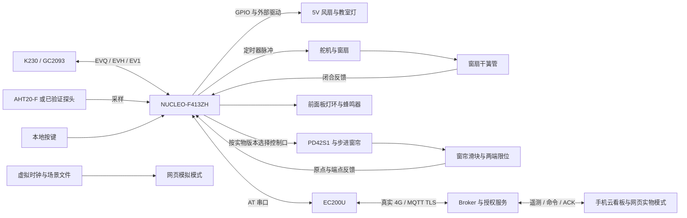

# EcoVision 整机接线与联调手册

2026-11-16 · 施工与联调基线 · 公共契约 1.0.0

STM32 是现场控制器。K230 负责识别人，EC200U 负责真实 4G，手机和网页经云端授权查看遥测、请求动作。桌面教室安装灯、风扇、舵机通风窗和步进窗帘。网页沙盒复现同一布置，并标记模拟或实物来源。[公共接口](../docs/INTERFACES.md) · [模型机械设计](实体沙盒搭建方案.md)

## 实体装配和接线

底板划分三块。前部是模型教室、灯和带罩风扇。侧墙内侧装窗帘轨，窗扇向另一侧开，舵机连杆和步进传动都加罩。后部固定 Nucleo、EC200U、驱动器及接线端子，给 USB、SIM、天线和调试口留空间。K230 摄像头朝桌外的真人区，其支架与运动机构分开固定。先用手检查窗扇和窗帘的全行程，确认两者互不碰擦，再联电。

### 已有板卡的串口分配

| 装配条件 | K230 视觉口 | EC200U AT 口 | PC 日志 |
| --- | --- | --- | --- |
| 确认是 UniKnect QADP-EC200UCNAA-Arduino V1.1，以 Nucleo-144 档叠插 | USART2，PD5 TX / PD6 RX，从 Morpho CN11-41 / 43 取线，CN11-49 GND 候选 | USART6，D1 / D0 经扩展板转接，J308 按指南核对 1–3 和 2–4 | Nucleo CN1 的 ST-LINK 虚拟串口，USART3 |
| EC200U 独立载板用跳线接主 AT 口 | USART6，PG14 TX / PG9 RX，CN10-14 / 16，CN10-22 GND 候选 | USART2，PD5 TX / PD6 RX，CN9-6 / 4，CN9-12 GND 候选 | 同上 |

两套分配择一。独立接线按 TX→RX、RX←TX，双方共参考地，并先核对逻辑电平。K230 侧 TX/RX 必须匹配庐山派实际排针与 FPIOA，串口按 EVQ、EVH、EV1 双向握手。EC200U 使用载板已转换的主 AT 口，模组裸引脚需按对应资料处理。板型、插针方向和跳帽确认后再落线，叠插时 D0/D1 已由 EC200U 使用。板载 AHT20-F 也只在实物匹配且 S502、I²C 地址和采样确认后启用。详见 [EC200U 叠插及独立联调指南](../firmware/stm32/EC200U-EcoVision-guide.md) · [Nucleo 排针索引](../firmware/stm32/NUCLEO-F413ZH-guide.md)。

### 外设资源及第一次通电

| 连接 | STM32 端资源 | 接线和第一次检查 |
| --- | --- | --- |
| QADP 板载 AHT20-F → STM32 | I²C1，PB8 SCL / PB9 SDA，D15 / D14，地址 `0x38` | S502 在 ARDU/MCU 档；先查应答再读温湿度。若板型不同，按实际温湿度传感器接口另核对。 |
| 本地接管按键 → STM32 | Nucleo B1 / PC13 候选；外置按钮也可用一根已确认的输入 | 核对按下电平、空闲电平和消抖，长按与短按分开验证。 |
| STM32 → 风扇、教室灯 | 两路输出 GPIO，现场编号 `FAN` 和 `LED` | 先用板载 LED 验证固件，再分别接外部驱动。继电器方案先核对 3.3V 触发、有效极性以及 5V 直流触点能力，常开触点从空载测默认关。风扇启动电流按实测校核。 |
| STM32 → 舵机；干簧管 → STM32 | 一路定时器输出 `WIN_SERVO`；一路数字输入 `WIN_CLOSED` | 核对位置型舵机、供电与信号门限；拆连杆空载测方向。窗框干簧管和窗扇磁铁先手动校到位，再装连杆校行程。 |
| STM32 → PD42S1；限位 → STM32 | 若版本匹配，预留脉冲、方向及使能；两路输入 `CURT_OPEN_LIM`、`CURT_CLOSE_LIM` | 以驱动器版本手册核对电源、电机和信号口。低速前先验证两端开关、方向、使能和停机。需要读取驱动报警时再核对可用接线，保留既有串口。 |
| STM32 → 灯环和蜂鸣器 | 灯环一路定时器/DMA 候选；蜂鸣器一路 GPIO 或定时器 | 灯环用于复示运行模式。蜂鸣器用于本地接管提示；确认类型和驱动电流，再做短鸣。 |
| 气体模块 → 独立诊断台架 | 首次用匹配电平的读取工具验证 | 查实物主芯片、量程、数据格式和单位。读数可做补充展示；是否进入整机控制由总控另定。 |

FAN 等字样是线束标签，具体 MCU 引脚由实际工程的引脚分配确认后填入。叠插时核对 D0/D1、I²C、D4/D6/D7/D9 及扩展板其它实占信号。先分配两路串口与本地负载，再给舵机和窗帘分配定时器和输入，最后加灯环。核对定时器通道、DMA 和中断有无冲突，灯环刷新与电机控制都采用异步处理。最终接线记录至少包含 `线号｜两端排针｜信号方向｜有效电平｜供电支路｜验证结果`，并配插头方向照片。

### 电源支路

| 支路 | 使用与验证 |
| --- | --- |
| P1 主控 | Nucleo 与 K230 各走对应板卡指定入口。先逐板通电，测复位和 UART；如果信号非隔离，按板卡方案共参考地。 |
| P2 通信 | EC200U 按实际载板供电。若匹配 QADP V1.1，参考现有指南的指定 5V 入口和带载能力。注册与发射时测电源稳定性。 |
| P3 5V 执行器 | 风扇、教室灯和继电器按各自规格使用外部负载支路。GPIO 只提供控制信号。灯环按版本和实测电流分配支路。 |
| P4 运动扩展 | 舵机按其型号供电，PD42S1 按驱动器和电机铭牌供电。两者分别验证启动瞬态，留易触达的切断点。测试风扇启动与 4G 发射、电机动作同时发生时有无压降/复位。 |

已有低压电源优先复用。保持各路正极独立，非隔离信号需要的地连接按接线表确认，防止 USB 与外部电源反灌。电机电源路径走适合的导线与接线端子。先用稳压台架供电完成验收，再评估电池短时演示，按整机 5000 元上限记录实际支出和缺件。

## 控制职责与状态

| 条件 | 核心灯与风扇以契约为准 | 窗户与窗帘的本地扩展建议 |
| --- | --- | --- |
| 上电 | AUTO，输出关，建立新启动会话 | 检查窗户干簧管和窗帘限位，通电时保持静止。窗帘由操作员触发低速回零后开放自动动作。 |
| AUTO、确认有人 | 连续 3 个新鲜正人数帧形成占用，灯亮；温度 ≥28℃ 连续 5 秒风扇开，≤27℃ 连续 5 秒关 | 窗帘拉开演示采光；窗户在需要通风时打开。对占用或通风需求的变化只发一次目标命令。 |
| AUTO、确认无人 | 连续有效 0 人 30 秒后两路关 | 提议关窗、拉合窗帘。关窗成功来自干簧管，拉合成功来自合帘端限位。 |
| REMOTE 或 LOCAL_OFF | 有效远程租期只对两路核心输出生效；实体长按进入 LOCAL_OFF、取消租期并关两路，实体短按恢复 AUTO | 提议 REMOTE 暂缓新的扩展自动动作。LOCAL_OFF 停止扩展运动并等待本地恢复。停驱后如何保持窗扇位置、何时重回零由硬件台架验证后交总控确认。 |
| 视觉/温度无效 | 按 5 秒视觉、10 秒温度门限识别失效；AUTO 先保持对应输出，关键故障持续 60 秒关两路。REMOTE 按有效租期执行 | 冻结依赖无效输入的自动决策。关窗反馈缺失、限位异常、回零/运动超时或驱动报警结束本次运动，记录原因并等待本地检查。 |
| EC200U 断链 | 本地继续运行，已有租期按原定单调时间到期。云端 15 秒无新鲜遥测标过期并禁下发 | 本地独立验证。失去网页连接时停止展示为实时反馈。 |

STM32 按周期独立推进感知、按键/限位、控制仲裁、负载驱动和 AT 收发。应用 ACK 由 STM32 校验并写入核心输出后发出。窗户和窗帘的本地试验日志记录请求、反馈、超时和停止原因。临时扩展状态先保存在独立日志，方案中涉及云控、状态字段或优先级的扩展均由总控明确后接入。

## 网页沙盒与云端接入

| 模式 | 当前状态 | 接下来的交付 |
| --- | --- | --- |
| 模拟 | 已有二维人员、温度、风扇、LED、AUTO、视觉/网络掉线、预设与 JSON 重放 | 验收页面交互；补 REMOTE 租期、本地优先和温度故障的契约用例；窗和帘分别模拟传感器反馈、未到位、回零与超时。旧场景文件应可继续重放。 |
| 实物 | 沙盒 `RealAdapter` 为占位。云端有受保护的 `GET /api/state` 及云看板控制路径 | 优先使用现有认证云看板做真实灯/风扇远控；与云端确定同源的沙盒读取和授权提交方式，复用现有授权和日志。窗帘和窗户预留独立状态，待扩展接口明确。 |

实物模式的状态来自云端转发的设备反馈。点击命令先进入 PENDING，关联 ACK 决定命令结果；10 秒无 ACK 标记结果未知，迟到结果只更新命令历史。实时状态靠新鲜遥测更新，来源、最近更新时间和过期状态对用户可见。实物模式关闭注入与导入，浏览器使用云端授权入口，Broker 身份留在设备和授权服务。 [现有网页启动说明](README.md) · [云端启动与权限说明](../cloud/README.md)

## 装机验收顺序

| 顺序 | 装机任务 | 放行证据 |
| --- | --- | --- |
| 1. 单板 | STM32 最小工程、板载灯与 SWD/VCP；K230 原模型；PC 读取 EC200U 版本、SIM 和注册状态 | 当前工程路径、烧录校验、0/1 人结果和脱敏 AT 回显。STM32 业务固件仍是当前关键路径。 |
| 2. 本地闭环 | 验证双 UART，接真实温湿度、按钮、灯和风扇；走真人进出、温控阈值、复位默认关和视觉故障 | 11-20 关口。留 UART、采样值、GPIO 日志及灯和风扇动作视频。温度注入单独标记。 |
| 3. 真实 4G | EC200U → 授权 Broker + 云端。验证证书与域名、保留命令处理、数据断链、命令和 ACK | 11-24 关口。实际 4G 一小时，计划周期样本 ≥95%；手机 20 条命令全部正确执行，至少 19 条在 10 秒内获 ACK。 |
| 4. 机械扩展 | 台架上独立验证窗户闭合/未到位、窗帘回零/两端限位/超时，装回模型检查互不干涉 | 记录电源波动、复位、限位和关窗反馈。核心配置 11-25 冻结，机械件通过本地用例后再决定是否进入最终演示配置。 |
| 5. 综合 | 从断电启动，跑自动、远控、本地接管、断网、感知故障和恢复 | 11-27 完成真实 8 小时，11-29 由另一人按操作手册复现。冻结后更改影响稳定性的接线或固件，按项目要求重跑。 |

状态记录采用 `用例｜模拟/实物｜日期｜板型与固件｜接线版本｜输入｜预期｜实际｜日志/视频｜PASS、FAIL、BLOCKED 或 NOT_RUN`。轨道、灯、屏幕显示以及 4G 日志分别作为对应步骤的证据。[项目验收标准](../docs/ACCEPTANCE.md)

本轮完成整机接线与控制设计。工作区有 K230 主机代码、云端与模拟沙盒；STM32 目录目前只有上板和通信指南。11-16 进度核查还记录了云端 TLS/MQTT 集成超时，先由云端组定位再接真实模组。实物装机、烧录和 4G 验收均待执行。[11-16 进度核查](../docs/PROGRESS-2026-11-16.md)

整机开工优先确认两项：EC200U 扩展板正反面丝印与跳帽，以选择串口方案；NUCLEO 的可构建工程路径和 ARM 工具链，以交付第一版灯与风扇控制。并行核对风扇铭牌、继电器丝印、舵机型号、PD42S1 版本及窗帘限位库存。能确认 QADP V1.1 时优先验证板载 AHT20-F。
